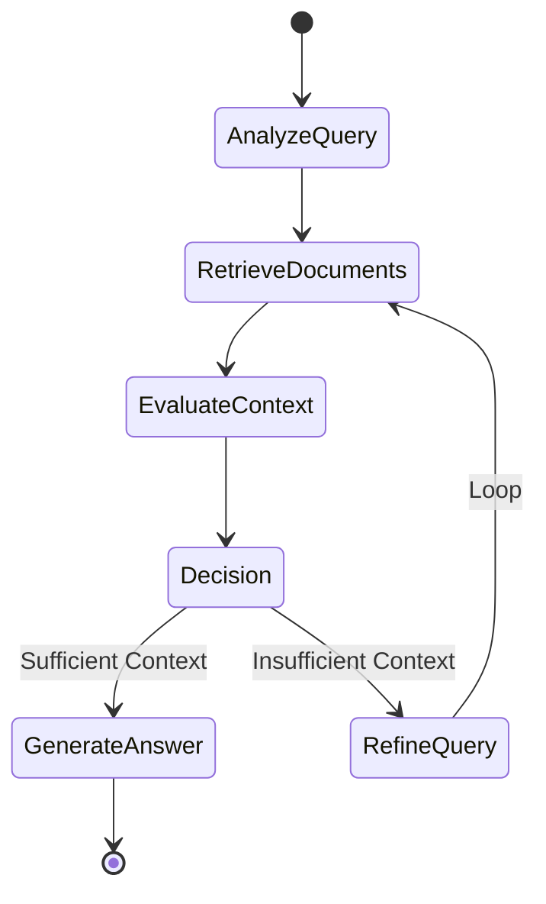

# RAG-Powered Agentic Q&A System


## Overview
An intelligent document Q&A system that ingests PDFs, generates embeddings, stores them in a vector database, and uses a LangGraph-based agentic workflow to retrieve, evaluate, and answer questions with accurate source citations.

## Architecture


## Agent Workflow


## Tech Stack
| Component | Technology |
|---|---|
| **Backend** | FastAPI |
| **LLM** | Google Gemini / OpenAI (configurable) |
| **Embeddings** | sentence-transformers (all-MiniLM-L6-v2) |
| **Vector DB** | ChromaDB |
| **Agent Framework** | LangGraph |
| **Frontend** | Streamlit |
| **Containerization** | Docker & docker-compose |

## Project Structure
```text
RAG-Agentic-QA-System/
├── backend/                  # FastAPI backend application
│   ├── app/                  # Application source code
│   │   ├── main.py           # FastAPI entrypoint
│   │   ├── ingestion/        # Document loaders and chunkers
│   │   ├── agent/            # LangGraph agent definitions
│   │   └── api/              # API routes
│   ├── tests/                # Pytest unit tests
│   │   ├── test_api.py
│   │   └── test_ingestion.py
│   ├── Dockerfile            # Backend container configuration
│   └── requirements.txt      # Backend dependencies
├── frontend/                 # Streamlit frontend application
│   ├── app.py                # Main UI logic
│   ├── Dockerfile            # Frontend container configuration
│   └── requirements.txt      # Frontend dependencies
├── docker-compose.yml        # Docker compose configuration
├── .env.example              # Environment variables template
└── README.md                 # Project documentation
```

## Quick Start

### Prerequisites
- Python 3.11+
- Google Gemini API key (free at [Google AI Studio](https://aistudio.google.com/apikey)) OR OpenAI API key

### Option 1: Local Setup
```bash
# Clone
git clone https://github.com/yourusername/RAG-Agentic-QA-System.git
cd RAG-Agentic-QA-System

# Backend
cd backend
python -m venv venv
venv\Scripts\activate  # Windows
pip install -r requirements.txt
cp ../.env.example ../.env  # Edit with your API key
uvicorn app.main:app --reload

# Frontend (new terminal)
cd frontend
pip install -r requirements.txt
streamlit run app.py
```

### Option 2: Docker
```bash
cp .env.example .env  # Edit with your API key
docker-compose up --build
```

## API Documentation
After starting the backend, visit http://localhost:8000/docs for interactive Swagger UI.

### Key Endpoints
* **`POST /upload`**: Upload PDF/TXT documents to be chunked and embedded.
* **`POST /query`**: Execute an agentic search query against the knowledge base.
* **`GET /collections`**: List all active document collections.
* **`DELETE /collections/{name}`**: Delete a specified knowledge base collection.
* **`GET /health`**: Healthcheck endpoint for service monitoring.

## Key Features
- 📄 Multi-format document ingestion (PDF, TXT)
- 🧠 Agentic RAG with iterative retrieval and self-evaluation
- 🔍 Transparent reasoning trace for every query
- 📚 Source citations with page numbers and relevance scores
- ⚡ Local embeddings (no API cost for embeddings)
- 🔄 Configurable LLM backend (Gemini / OpenAI)
- 🐳 Fully containerized with Docker

## How the Agent Works
The system uses a 5-step intelligent workflow powered by LangGraph:
1. **Query Analysis** — The LLM analyzes and optimizes the user's search query for better retrieval.
2. **Document Retrieval** — Performs vector similarity search in ChromaDB using local embeddings.
3. **Context Evaluation** — The LLM evaluates if the retrieved documents contain sufficient information to answer the question.
4. **Query Refinement** (if needed) — If context is insufficient, the LLM generates an alternative search query and loops back to retrieval.
5. **Answer Generation** — Once sufficient context is gathered, the LLM synthesizes a detailed answer with precise page-level citations.

## License
MIT
