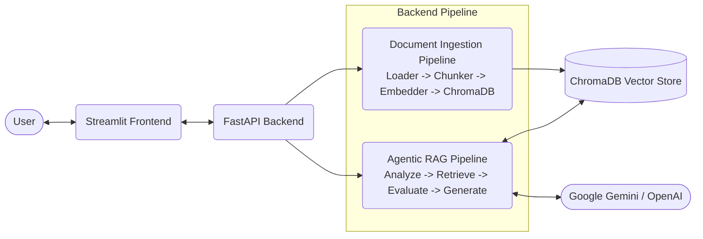
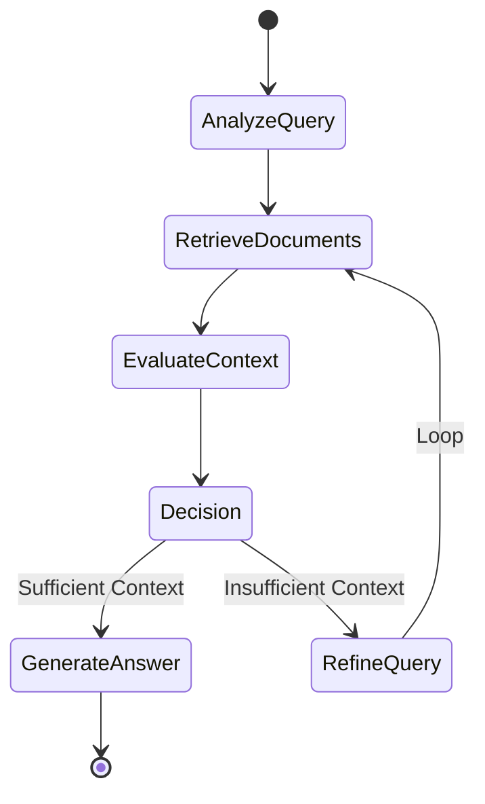

# RAG-Powered Agentic Q&A System


## Overview
An intelligent document Q&A system that ingests PDFs, generates embeddings, stores them in a vector database, and uses a LangGraph-based agentic workflow to retrieve, evaluate, and answer questions with accurate source citations.

## Architecture


## Agent Workflow


## Tech Stack
| Component | Technology |
|---|---|
| **Backend** | FastAPI |
| **LLM** | Google Gemini / OpenAI (configurable) |
| **Embeddings** | sentence-transformers (all-MiniLM-L6-v2) |
| **Vector DB** | ChromaDB |
| **Agent Framework** | LangGraph |
| **Frontend** | Streamlit |
| **Containerization** | Docker & docker-compose |

## Project Structure
```text
RAG-Agentic-QA-System/
├── backend/                  # FastAPI backend application
│   ├── app/                  # Application source code
│   │   ├── main.py           # FastAPI entrypoint
│   │   ├── config.py         # Settings loaded from .env
│   │   ├── models.py         # Request/response schemas
│   │   ├── ingestion/        # Document loader, recursive chunker, embedder
│   │   ├── vectorstore/      # ChromaDB wrapper (multi-collection)
│   │   ├── agent/            # LangGraph state, nodes and graph
│   │   └── api/              # Routes and shared dependencies
│   ├── tests/                # Pytest suite (no API key needed)
│   ├── pytest.ini
│   ├── Dockerfile            # Backend container configuration
│   └── requirements.txt      # Backend dependencies
├── frontend/                 # Streamlit frontend application
│   ├── app.py                # Main UI logic
│   ├── Dockerfile            # Frontend container configuration
│   └── requirements.txt      # Frontend dependencies
├── docker-compose.yml        # Docker compose configuration
├── .env.example              # Environment variables template
├── LICENSE
└── README.md                 # Project documentation
```

## Quick Start

### Prerequisites
- Python 3.11+
- Google Gemini API key (free at [Google AI Studio](https://aistudio.google.com/apikey)) OR OpenAI API key

### Option 1: Local Setup
```bash
# Clone
git clone https://github.com/huzaifajsr/RAG-Agentic-QA-System.git
cd RAG-Agentic-QA-System

# Backend
cd backend
python -m venv venv
venv\Scripts\activate          # Windows
# source venv/bin/activate      # macOS / Linux
pip install -r requirements.txt
cp ../.env.example .env         # then edit .env and add your API key
uvicorn app.main:app --reload

# Frontend (new terminal)
cd frontend
pip install -r requirements.txt
streamlit run app.py
```

### Option 2: Docker
```bash
cp .env.example .env  # Edit with your API key
docker-compose up --build
```

## API Documentation
After starting the backend, visit http://localhost:8000/docs for interactive Swagger UI.

### Key Endpoints
* **`POST /upload`**: Upload a PDF/TXT file (multipart field `file`, optional form field `collection_name`). Files are size-limited (`MAX_FILE_SIZE_MB`) and filenames are sanitised.
* **`POST /query`**: Run the agent. Body: `{"question": "...", "collection_name": "documents", "top_k": 5}` (`collection_name` and `top_k` are optional). Returns the answer, cited sources, the reasoning trace and the number of retrievals made.
* **`GET /collections`**: List collections with their chunk counts.
* **`GET /collections/{name}`**: Chunk count for one collection (404 if missing).
* **`DELETE /collections/{name}`**: Delete the named collection (404 if missing).
* **`GET /health`**: Healthcheck endpoint for service monitoring.

If the LLM API key is missing, `/query` returns `503` with a message saying which key to set.

## Key Features
- 📄 Multi-format document ingestion (PDF, TXT)
- 🧠 Agentic RAG with iterative retrieval and self-evaluation
- 🔍 Transparent reasoning trace for every query
- 📚 Source citations with page numbers and relevance scores
- ⚡ Local embeddings (no API cost for embeddings)
- 🔄 Configurable LLM backend (Gemini / OpenAI)
- 🐳 Fully containerized with Docker

## How the Agent Works
The system uses a 5-step intelligent workflow powered by LangGraph:
1. **Query Analysis** — The LLM analyzes and optimizes the user's search query for better retrieval.
2. **Document Retrieval** — Performs vector similarity search in ChromaDB using local embeddings.
3. **Context Evaluation** — The LLM evaluates if the retrieved documents contain sufficient information to answer the question.
4. **Query Refinement** (if needed) — If context is insufficient, the LLM generates an alternative search query and loops back to retrieval. New chunks are added to (not swapped for) what was already found, so a weaker follow-up search never discards good earlier results.
5. **Answer Generation** — Once context is sufficient, or after `MAX_AGENT_ITERATIONS` retrievals, the LLM synthesizes an answer citing document names and page numbers.

`MAX_AGENT_ITERATIONS` is the maximum number of retrievals per question (default 3). The LLM client and the compiled graph are created once at startup and reused for every request.

## Running Tests
```bash
cd backend
pip install -r requirements.txt
pytest
```
The 44 tests use an in-memory ChromaDB, a fake embedding model and a scripted fake LLM, so they need no API key or model download and run in a few seconds. They cover chunking limits and overlap, collection management, the agent's retry loop and context accumulation, and the API (uploads, size limits, filename sanitisation, error codes).

## License
MIT — see [LICENSE](LICENSE).
